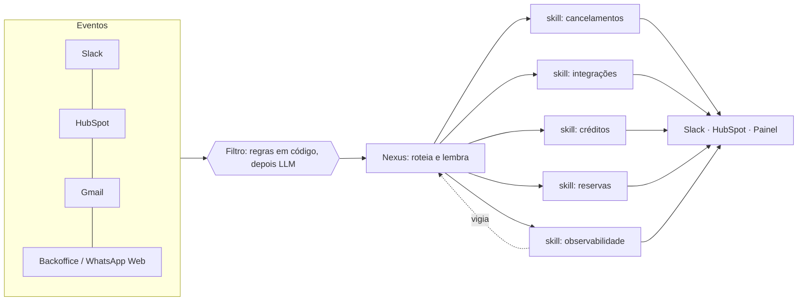

# Arquitetura

## Componentes

**Filtro.** Primeiro regras determinísticas (janela de horário, canal permitido, duplicata). O que passa pode
ser avaliado por um modelo pequeno ("isso exige ação?"). A maioria do ruído morre na primeira etapa, sem custo de modelo.

**Nexus (roteador).** Conhece todas as skills, escolhe qual ativar e assina a saída com o nome dela. Não executa
ações pesadas por conta própria.

**Skills.** Cada skill tem gatilho, passos, formato de saída e limites. Ficam em arquivos, o que torna a mudança de comportamento
revisável em um diff.

**Estado durável.** Cursor de leitura ("último evento processado"), logs de varredura e relatórios ficam fora do agente.
Isso evita eventos repetidos e permite detectar *regressão* de cursor e execução concorrente.

**Monitorius (observabilidade).** Verifica se as rotinas rodaram, confere os dois agendadores antes de declarar "agente parado" e
publica digest diário e relatório semanal.

## Fluxo de um evento

1. Evento chega (ex.: cancelamento de reserva).
2. O filtro descarta o que está fora de regra.
3. O Nexus escolhe a skill e carrega só o contexto necessário.
4. A skill age, respeitando guardrails e tetos.
5. A saída vai ao destino certo (canal de negócio ou DM de infra) e o estado é atualizado.
